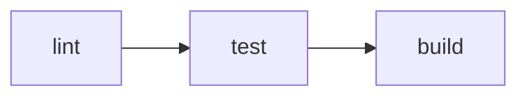

# Run

Use `vp run <name>` to run a script from `package.json` or a task defined under `run.tasks` in `vite.config.ts`. It supports caching, dependency ordering, and running commands across workspace packages. You can use it through either the [global CLI](/guide/global-cli) or the [project-local CLI](/guide/local-cli).

::: tip
`vpr` is shorthand for `vp run`. You can replace `vp run` with `vpr` in the examples below.
:::

## Overview

Start with the scripts in your project's `package.json`:

```json [package.json]
{
  "scripts": {
    "build": "vp build",
    "lint": "vp lint",
    "test": "vp test"
  }
}
```

Run a script by name:

```bash
vp run build
```

This runs the `build` script, which calls the built-in `vp build` command:

```
$ vp build
✓ built in 69s
```

Run `vp run` without a name to select a script or task interactively:

```
Select a task (↑/↓, Enter to run, type to search):

  › build: vp build
    lint: vp lint
    test: vp test
```

With [shell completion](/guide/env#shell-completion) enabled, press Tab after `vp run ` or `vpr ` to complete script and task names from your project.

## Built-in Commands vs Scripts

`vp <command>` runs a built-in command. `vp run <name>` runs the script or task your project defines with that name. Defining a script or task does not override a built-in command:

| Command                    | What it runs                                                           |
| -------------------------- | ---------------------------------------------------------------------- |
| `vp dev`                   | The built-in Vite dev server                                           |
| `vp run dev` / `vpr dev`   | The `dev` script in `package.json`, or the `dev` task in `run.tasks`   |
| `vp test`                  | The built-in Vitest command                                            |
| `vp run test` / `vpr test` | The `test` script in `package.json`, or the `test` task in `run.tasks` |

`build`, `preview`, `lint`, `fmt`, `check`, and `pack` work the same way.

Use `vp run <name>` when you want your project's command. For example, in an Astro project with a `"dev": "astro dev"` script, `vp run dev` starts Astro. `vp dev` starts the built-in Vite dev server.

If your Astro, Nuxt, or VitePress project has no `dev` script or task, running `vp dev` without arguments can suggest a framework command such as `vp exec astro dev` or `vp exec vitepress dev docs`. The command still starts the Vite dev server.

## Caching

By default, `vp run` caches [tasks defined in `vite.config.ts`](#task-definitions), but not `package.json` scripts. Add `--cache` to cache a script run:

```bash
vp run --cache build
```

```
$ vp build
✓ built in 69s
```

When the inputs are unchanged, `vp run` replays the cached output and restores the output files on the next run:

```
$ vp build ◉ cache hit, replaying
✓ built in 69s

---
vp run: cache hit, 69s saved.
```

If an input changes, `vp run` runs the command again:

```
$ vp build ○ cache miss: 'src/main.ts' modified, executing
```

`vp run` uses [automatic data tracking](/guide/automatic-data-tracking) to identify cache inputs and outputs. See [When Is Caching Enabled?](/guide/cache#when-is-caching-enabled) for how flags and configuration control caching.

## Task Definitions

Define a task under `run.tasks` in `vite.config.ts` when you need dependency ordering or cache configuration. Each task needs an explicit `command`.

To convert the `build` script above into a task, remove it from `package.json` and add it to `run.tasks`. A name must appear in only one of these files. The `lint` and `test` scripts can stay in `package.json`:

```ts [vite.config.ts]
import { defineConfig } from 'vite-plus';

export default defineConfig({
  run: {
    tasks: {
      build: {
        command: 'vp build',
        dependsOn: ['lint'],
      },
      deploy: {
        command: 'deploy-script --prod',
        cache: false,
        dependsOn: ['build', 'test'],
      },
    },
  },
});
```

You still run the build with `vp run build`. It now waits for `lint` and uses caching by default. The `deploy` task disables caching because it changes an external system.

See [Run Config](/config/run) to configure environment variables, file inputs, outputs, and other task settings.

## Task Dependencies

Use [`dependsOn`](/config/run#dependson) to declare which scripts or tasks must finish before a task starts. In the configuration above, `deploy` waits for `build` and `test`, and `build` waits for `lint`.

String entries name a script or task in the current package or another workspace package:

```ts [vite.config.ts]
dependsOn: [
  'build', // same package
  '@my/core#build', // another package
];
```

Use the object form to run a named script or task in each workspace dependency. For example, move `test` from `package.json` into `run.tasks` to make it wait for dependency builds:

```ts [vite.config.ts]
import { defineConfig } from 'vite-plus';

export default defineConfig({
  run: {
    tasks: {
      test: {
        command: 'vp test',
        dependsOn: [{ task: 'build', from: 'dependencies' }],
      },
    },
  },
});
```

In this example, `vp run test` checks the current package's `dependencies`. It runs `build` in each direct workspace dependency that defines that script or task before it starts `test`.

Use an array when you need more than one dependency field:

```ts [vite.config.ts]
dependsOn: [{ task: 'build', from: ['dependencies', 'devDependencies'] }];
```

## Running in a Workspace

By default, `vp run` selects the script or task from the package containing your current working directory:

```bash
cd packages/app
vp run build
```

To select another workspace package, use `<package>#<name>`:

```bash
vp run @my/app#build
```

The `-r` and `-t` options use the workspace dependencies declared in each package's `package.json` to determine which packages run and in what order. Use [`dependsOn`](#task-dependencies) for additional ordering between named scripts and tasks.

### Recursive (`-r`)

Run the named script or task across workspace packages, in dependency order:

```bash
vp run -r build
```

### Transitive (`-t`)

Run the named script or task in a package and its workspace dependencies:

```bash
vp run -t @my/app#build
```

If `@my/app` depends on `@my/utils`, which depends on `@my/core`, this runs `build` in `@my/core`, then `@my/utils`, then `@my/app`.

### Filter (`--filter`)

Select packages by name, directory, or glob pattern. The syntax matches pnpm's `--filter`:

```bash
# By name
vp run --filter @my/app build

# By glob
vp run --filter "@my/*" build

# By directory
vp run --filter ./packages/app build

# Include dependencies
vp run --filter "@my/app..." build

# Include dependents
vp run --filter "...@my/core" build

# Exclude packages
vp run --filter "@my/*" --filter "!@my/utils" build
```

With multiple `--filter` flags, `vp run` selects packages that match any inclusion filter, then removes packages that match an exclusion filter.

`vp run` prints a warning for each filter that matches no packages. If no packages are selected, it exits successfully without running any commands. Add `--fail-if-no-match` to fail the run when any filter matches no packages.

### Workspace Root (`-w`)

Run the named script or task in the workspace root package:

```bash
vp run -w build
```

## Compound Commands

`vp run` splits commands joined with `&&` into subtasks and runs them in order. When [caching is enabled](/guide/cache#when-is-caching-enabled), each subtask has its own cache entry. This works for both scripts and tasks:

```json [package.json]
{
  "scripts": {
    "check": "vp lint && vp build"
  }
}
```

Run the `check` script with caching enabled:

```bash
vp run --cache check
```

```
$ vp lint
Found 0 warnings and 0 errors.

$ vp build
✓ built in 28ms

---
vp run: 0/2 cache hit (0%), 2/2 successful.
```

If only a build input changes, such as `index.html`, the next `vp run --cache check` reuses the lint result and runs the build again:

```
$ vp lint ◉ cache hit, replaying
$ vp build ○ cache miss: 'index.html' modified, executing
✓ built in 30ms

---
vp run: 1/2 cache hit (50%), 2/2 successful, 120ms saved.
```

### Nested `vp run`

When a script or task calls `vp run`, the selected commands become part of the same run. With caching enabled, each nested command has its own cache entry:

```json [package.json]
{
  "scripts": {
    "ci": "vp run lint && vp run test && vp run build"
  }
}
```

Running `vp run ci` runs `lint`, `test`, and `build` in order:



You can also use flags in nested commands. For example, `vp run -r build` inside a script runs `build` across workspace packages.

::: info
To run `build` across a workspace, you can define this script in the root `package.json`:

```json [package.json (root) ~vscode-icons:file-type-node~]
{
  "scripts": {
    "build": "vp run -r build"
  }
}
```

The recursive run includes the root package, whose `build` script would call itself. `vp run` skips that self-reference and runs `build` in the other packages.
:::

## Execution Summary

Use `-v` to show a detailed execution summary:

```bash
vp run -r -v build
```

```
━━━━━━━━━━━━━━━━━━━━━━━━━━━━━━━━━━━━━━━━━━━━━━━
    Vite+ Task Runner • Execution Summary
━━━━━━━━━━━━━━━━━━━━━━━━━━━━━━━━━━━━━━━━━━━━━━━

Statistics:   3 tasks • 3 cache hits • 0 cache misses
Performance:  100% cache hit rate, 468ms saved in total

Task Details:
────────────────────────────────────────────────
  [1] @my/core#build: ~/packages/core$ vp build ✓
      → Cache hit - output replayed - 200ms saved
  ·······················································
  [2] @my/utils#build: ~/packages/utils$ vp build ✓
      → Cache hit - output replayed - 150ms saved
  ·······················································
  [3] @my/app#build: ~/packages/app$ vp build ✓
      → Cache hit - output replayed - 118ms saved
━━━━━━━━━━━━━━━━━━━━━━━━━━━━━━━━━━━━━━━━━━━━━━━
```

Use `--last-details` to show the summary from the last run without running any commands again:

```bash
vp run --last-details
```

## Concurrency

By default, `vp run` runs up to four scripts or tasks at a time. Use `--concurrency-limit` to change this limit:

```bash
# Run up to 8 builds at once
vp run -r --concurrency-limit 8 build

# Run one build at a time
vp run -r --concurrency-limit 1 build
```

You can also set the limit with the `VP_RUN_CONCURRENCY_LIMIT` environment variable. The `--concurrency-limit` flag takes priority.

### Parallel Mode

Use `--parallel` to start the selected scripts and tasks without dependency ordering or a concurrency limit:

```bash
vp run -r --parallel dev
```

This is useful for independent commands, such as dev servers in different packages. Combine `--parallel` with `--concurrency-limit` to limit how many run at once:

```bash
vp run -r --parallel --concurrency-limit 4 dev
```

## Additional Arguments

`vp run` passes arguments after the script or task name to its command:

```bash
vp run test --reporter verbose
```
