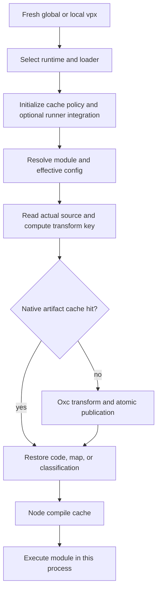

# RFC: Accelerate vpx Warm Starts with Vite Task Cache APIs

- Status: Draft; opt-in v1 prototype implemented
- Related: [Script execution](./vpx-script-execution.md), [Task caching](../docs/guide/cache.md), [Directory layout](./directory-layout.md)
- Original benchmark baseline: Vite+ `a9cc41dedf612b2a991da2968cb4107b46bccf38`; Vite Task `a3c087a771a116f7c60220fc72738703eb45ac2e`; oxc-node `6d5376df15df5446a91d01d53f3d7965d8b9708e`. The current branch uses the newer pins in [Cargo.toml](../Cargo.toml) and [the upstream manifest](../packages/tools/.upstream-versions.json); see [the results](./vpx-warm-start-cache-results.md) for the measured build identities.

## Proposal

Persist the compilation work used by `vpx <script>` across fresh processes. Cache Oxc transform artifacts in the native loader, enable Node.js's compile cache in the script process, and use Vite Task's cache-control API to keep these derived files out of task dependency tracking. Every invocation still executes the script, with its current arguments, environment, and side effects.

The performance goal is **10× faster end-to-end warm startup**. That goal is unproven, and a transform cache alone cannot credibly meet it across the existing benchmark suite. Start with a measured feasibility gate, then implement the layers that address the measured costs. A 10× transform speedup or a `vp run` task-result cache hit does not satisfy the startup goal.

Vite Task currently exposes coordination APIs, not a public transform artifact store. This proposal uses those APIs immediately and proposes a small synchronous storage API in Vite Task. It also requires an upstream oxc-node cache hook; the current Vite+ wrappers cannot intercept every transform safely.

The scope is the script execution feature described in the related RFC, including global and project-local `vpx`, ESM, CommonJS, workers, and watch restarts. Package-binary lookup and package installation are outside this design.

## First prototype

The prototype implements native transform/classification persistence and optional Node compile-cache activation. Enable both with `VPX_CACHE=1 vpx script.ts`; use `VPX_CACHE=transform` or `VPX_CACHE=compile` to measure each layer separately. `VPX_DISABLE_CACHE=1` disables both managed layers, and the watcher's `--no-cache` propagates that policy to restarted scripts. Caching remains off by default.

The [native store](../packages/cli/binding/src/oxc_node/cache.rs) is owned by Vite+, with `ignoreInput` and `ignoreOutput` used only for Vite Task coordination. The [tracked oxc-node patch](../packages/tools/patches/oxc-node-transform-cache.patch) supplies the proposed native hook until an upstream API is available. Setup applies this patch to the pinned source and rejects incompatible upstream changes. This is an explicit prototype exception to the upstream-first sequence below.

The store partitions records by compiler/loader/helper build identity and exact Node version. It hashes source bytes and complete normalized transform settings. Small transforms from the same source directory share a pack. A loader keeps up to four directory packs in memory and verifies the selected record on each hit. Each pack holds up to 4 MiB. Sources or encoded outputs over 64 KiB use individual files, as do new entries when a pack is full or its writer lock is busy. See the [packed store](../packages/cli/binding/src/oxc_node/cache/packed.rs).

Sources and config selection remain live on hits. Managed Node caching preserves explicit user cache settings and stays off for precise coverage. See [loader initialization](../packages/cli/src/script-cache.ts).

Version 1 limits individual records to 64 MiB, but does **not** implement the proposed total-size budget, age eviction, or a cleanup command. Its owned directories are `<CACHE>/vpx/transform/<build>/<runtime-hash>/` and `<CACHE>/vpx/node/`; Node controls its own internal layout. The existing `vp cache clean` still clears task results only. Automatic cleanup and broader platform/lifecycle coverage are required before considering default activation.

The new [benchmark harness](../bench/vpx-cache.ts) compares an independently built baseline and candidate using the five unchanged historical fixtures. It retains raw timings, validates each execution, and measures direct, local, and global startup separately. [The v1 results](./vpx-warm-start-cache-results.md) record the measured gains, regressions, and remaining gaps against this RFC's targets.

## Baseline behavior and available APIs

The global launcher selects Node.js and the loader, then replaces itself on Unix. The project-local bin first starts Node.js, parses the invocation, and then replaces itself on Unix when no IPC relay is needed; Windows and IPC cases spawn the script process. Both use `script-preload.cjs` and `script-register.js`; older supported Node.js releases use a separate ESM hooks thread. See [the global launcher](../crates/vp_global_cli/src/commands/vpx_script.rs), [the local launcher](../packages/cli/src/vpx-bin.ts), and [the loader contract](./vpx-script-execution.md#cliloader-contract).

At the baseline revision, the [native wrapper](../packages/cli/binding/src/oxc_node.rs) forwards CommonJS transforms and ESM loads to oxc-node. The loader has process-local state but no persistent transform cache. The [local bin](../packages/cli/bin/vpx) already calls `enableCompileCache()` for its own process; the [script preload](../packages/cli/src/script-preload.ts) does not explicitly enable it for the new script process.

At the pinned Vite Task revision:

| Surface                          | What exists                                                                      | Use in this design                                            |
| -------------------------------- | -------------------------------------------------------------------------------- | ------------------------------------------------------------- |
| `@voidzero-dev/vite-task-client` | `ignoreInput`, `ignoreOutput`, `getEnv`, `getEnvs`, `disableCache`               | Coordinate with an enclosing `vp run`; no artifact lookup API |
| `vt_client::Client`              | Synchronous IPC to an enclosing runner; absent outside it                        | Optional setup work, never a round trip per module            |
| `ExecutionCache`                 | Internal SQLite task results, fingerprints, terminal output, and output archives | Keep separate from loader artifacts                           |
| `vt_materialized_artifact`       | Materialization of embedded static bytes                                         | Does not store runtime transform results                      |

`ExecutionCache` lives behind private `session::cache`; its methods are not an external Rust API. Opening it initializes storage and locking, while lookup and update use async task machinery. Replaying a task's output would skip script execution. Neither behavior belongs in the synchronous module-loading path.

The public `disableCache()` currently forwards to a temporary no-op. This proposal must not depend on it to prevent incorrect task caching. Sources: [client API][vt-client], [Rust client][vt-rust-client], [module visibility][vt-session], [task storage][vt-storage].

## Define and test the 10× target

A warm start means a **new OS process** with artifacts from a previous successful execution of the same sources and settings. Node.js and dependencies are already installed. Measure an unchanged workspace, after a completed priming run, with ordinary warm filesystem caches. A live watcher parent is a separate scenario; reusing the application's Node.js process is not equivalent.

The primary metric is elapsed wall time from the benchmark parent launching `vpx` to a readiness marker emitted after the fixture's startup imports and initialization. Also measure launch-to-exit for short scripts. The baseline is the current implementation on the same machine, runtime, entry point, and fixture with its normal warm behavior, not a cold competitor or an artificially disabled baseline.

For each agreed workload and launcher:

```text
speedup = baseline warm-start p50 / candidate warm-start p50
target: speedup >= 10
```

Track p95 as well; a candidate must not improve the median by making tail latency worse. Report every row and absolute milliseconds. Do not hide a failing launcher or fixture in an aggregate.

### Existing evidence and the startup floor

The [earlier performance table](./vpx-script-execution.md#performance) reports these Node.js 24.12 medians on an Apple M4 Pro. These are historical launch-to-exit measurements, not new results for this proposal:

| Fixture                   | Global vpx | Local vpx | Global time required for 10× |
| ------------------------- | ---------: | --------: | ---------------------------: |
| One small TypeScript file |      34 ms |     52 ms |                       3.4 ms |
| 300-module ESM graph      |      75 ms |     93 ms |                       7.5 ms |
| 1.8 MB CommonJS source    |     100 ms |    118 ms |                        10 ms |

The same measurements attribute 5–10 ms to global dispatch and runtime/loader lookup, and 23–30 ms to the local launcher's initial Node.js process. Even eliminating all transforms cannot remove those costs.

Use the following model to test feasibility, with exclusive phase timings rather than overlapping timers:

```text
T = dispatch + Node startup + loader initialization + resolve/config/read
    + Oxc transform + V8 compilation + application initialization

T_warm = unavoidable work + validation + artifact reads + remaining compilation
maximum speedup <= T_baseline / unavoidable work
```

Before implementation, measure equivalent precompiled JavaScript under the same launcher shape and a plain Node.js process, both with the proposed warm Node compile-cache policy and representative initialization. These are diagnostic estimates, not replacement baselines or mathematical lower bounds: they can retain work that further optimization removes. If they exceed `T_baseline / 10`, investigate the remaining phases. Reject feasibility for a row only when measured unavoidable costs already exceed that budget.

The existing small fixtures remain in the acceptance report. Add representative real startup-heavy scripts before optimizing, plus larger synthetic graphs to locate the scaling limit. Do not select only a favorable large source after seeing the results. If 10× is unattainable for the agreed suite, report the gap and discuss the workload definition or process model explicitly. Shipping a useful smaller gain does not complete the 10× objective.

## Architecture



### Vite Task coordination

Reuse `ignoreInput(root)` and `ignoreOutput(root)` for each verified, dedicated transform and Node compile-cache directory, once during loader initialization. Register the managed transform root before its first access. An environment-enabled Node cache can be used before preload runs; report its safe directory as soon as it is known, and verify that the runner applies the exclusion to earlier accesses when it finalizes tracking. [The Vitest integration](../packages/cli/src/define-config.ts) already uses cache-directory exclusions. They prevent derived artifacts from becoming inferred task inputs, restored outputs, or read/write overlaps. Explicit user input/output globs remain governed by task configuration.

Never exclude a broad user-provided `NODE_COMPILE_CACHE` parent: it might be the workspace root and contain sources. Use the actual dedicated directory reported by Node's API, verify that excluding it cannot cover source/config locations, and otherwise omit the exclusion. Preserve a user-enabled cache without claiming safe task integration in that case; retain the runner's normal checks. For Vite+-managed activation, choose a separate owned directory or leave compile caching disabled when safe isolation cannot be established.

These calls are optional outside `vp run`, where the client is a no-op. They must not start a runner, evaluate `vite.config.ts`, construct a task graph, or fetch anything. Reuse the existing client package and its lazy runner-supplied binding. If a connected client reports an IPC error, do not silently continue as though dependency reporting succeeded. The loader must retain the client error or use an upstream-supported, verified opt-out; today's `disableCache()` is insufficient.

Source, package metadata, config reads, and missing-path probes stay visible on cache hits. The artifact lookup occurs **after** source reading and effective-config selection. Ignoring the artifact directory is safe only because it does not hide those real dependencies. A warm loader cache inside a cold task cache must learn the same input dependencies as an uncached loader.

Keep current environment selection and `--tsconfig` precedence. `getEnv`/`getEnvs` are available for cooperative tracking, but restoring filtered application variables is a separate semantic change. The initial implementation hashes the effective loader settings and retains existing task `cache.env` rules. It must never recover an inherited `VP_SCRIPT_TSCONFIG` through `getEnv` after the launcher intentionally cleared it.

### Proposed Vite Task artifact API

Add a lightweight Rust artifact store to Vite Task, tentatively `vt_artifact_cache`. This name and interface are **new API proposals**, not dependencies available at the pinned revision:

```rust
// Illustrative interface; all operations are synchronous and in-process.
impl ArtifactCache {
    fn open(root: &AbsolutePath, namespace: &str) -> io::Result<Self>;
    fn get(&self, key: &ArtifactKey) -> io::Result<Option<Vec<u8>>>;
    fn put_if_absent(&self, key: &ArtifactKey, value: &[u8]) -> io::Result<()>;
}
```

The store owns versioned byte records, atomic publication, corruption detection, concurrent access, and bounded eviction. The caller owns semantic keys and payload schemas. It must work without `Session`, Tokio, runner IPC, a daemon, or a workspace. Storage operations must not perform remote requests. Vite+ embeds the adapter in its existing native binding.

Start with sharded immutable files, one bounded record per key, and lazy directory creation on the first write. Read one record per lookup; do not open the task SQLite database or extract archives for each module. Reuse Vite Task's suitable filesystem/serialization utilities, but do not expose the task cache's internal schema as a general KV API. Benchmark small-file lookup overhead before committing to this storage format; an index or packed records is a later option if measured I/O dominates.

This gives Vite Task ownership of a reusable storage API without imposing task execution semantics on compiler artifacts. If upstream does not accept that API, a Vite+-owned adapter can support the performance experiment, but it must be identified as separate storage, not advertised as reuse of an existing Vite Task artifact API.

### Native Oxc cache boundary

Introduce a host-provided synchronous cache backend in oxc-node. It must cover `OxcTransformer::transform`, `transform_output`, and the classification/transform work in `load_commonjs_esm`. The last path parses and transforms directly, so wrapping only `oxc_transform` is insufficient. See [the pinned native loader][oxc-loader].

Oxc-node builds a normalized transform request after selecting the effective config and deciding the transform variant. Its host callback uses the Vite Task artifact store. Keep key construction beside compiler behavior so Vite+ does not duplicate tsconfig parsing or maintain a partial compiler-option list. The callback must not re-enter JavaScript or await a promise from a synchronous CJS/ESM hook.

The stored result is a tagged artifact:

```text
Transformed { code, source_map, output_format, classification }
DeferCommonJs { classification }
```

Preserve the current CJS `source: null` deferral; substituting cached source there can change Node.js behavior or cause duplicate transforms. A stored `DeferCommonJs` is only a classification hint: retain the live source-provenance check outside the cache. When another hook supplies source, oxc-node's `source_matches_file` check must still succeed before deferring to Node's disk read. The same supplied bytes with different current disk contents cannot reuse an earlier deferral decision. Preserve the existing CJS and ESM source-map assembly paths and helper resolution. Initially cache successful, diagnostic-free transforms and successful classification only. Re-run errors, warnings, unsupported inputs, and pass-through modules through the existing paths.

The existing JS loader entry filenames and global/local selection contract stay valid. All behavior lives with the selected loader and matching native binding. Loader settings remain thread-local even when artifact storage is shared. Freeze and pass cache policy alongside tsconfig/dependency settings to off-thread ESM hooks; initialize it in application workers and forked scripts that inherit the loader as well.

### Transform keys and invalidation

Use a versioned, deterministic encoding and a collision-resistant content digest. Hash source bytes already provided to the transform; do not reread the file just to construct a key. The key contains:

| Input                                                                              | Reason                                                                                                                  |
| ---------------------------------------------------------------------------------- | ----------------------------------------------------------------------------------------------------------------------- |
| Actual source bytes                                                                | Same-size edits or restored timestamps must miss; another hook may supply different bytes                               |
| Filename, extension, relevant URL identity, and path context used by the transform | Source type, relative rewrites, and source maps depend on identity                                                      |
| Effective compiler options                                                         | Includes JSX, decorators, class fields, import rewriting, and all future code-generation options                        |
| Transform variant and input format                                                 | Distinguish CJS, preserved/forced ESM, format classification, and top-level-await policy                                |
| Runtime syntax capabilities                                                        | For example, native `using` differs between supported Node.js lines; start with conservative exact-runtime partitioning |
| Loader/compiler build, helper ABI/namespace, and cache schema                      | Prevent cross-version reuse after implementation or runtime-helper changes                                              |

Build identity comes from the selected loader/binding, not the global launcher's version. Development builds need a generated content/build identity, not just an unchanged package version. Path identity must follow the loader's symlink policy; do not unconditionally canonicalize away distinct module URLs.

Resolve tsconfig ownership and package format on every fresh process before lookup. A newly created nearer tsconfig, an `extends` change, or a package `type` change must take effect. The transform config and the import resolver's config can differ, so one cannot stand in for the other. With live resolution, a `paths` or package `exports` edit may select a new file even when a previous file's transform artifact remains valid.

Do not put script arguments or the whole application environment in the transform key: they do not change generated code, and the script still receives them at execution. Any loader setting that does affect code belongs in the normalized request. Do not use persistent `mtime + size` validation as proof that source content is unchanged.

### Node compile cache

Enable the compile cache in the script process early in `script-preload`, before user modules load. Oxc artifacts avoid transformation; Node's cache addresses JavaScript compilation. Use the supported string-directory API, honor an explicit `NODE_COMPILE_CACHE` location and `NODE_DISABLE_COMPILE_CACHE`, and initialize workers separately. Keep Node's version-specific storage opaque. Disable automatic activation for precise coverage runs; verify hook-path eligibility on every supported runtime. Node documents possible cold-load overhead, per-process activation, exit-time persistence, and coverage limitations in its [compile-cache API](https://nodejs.org/api/module.html#module-compile-cache).

The local launcher's existing activation does not automatically enable the replacement process. It may also exit through `execve` before ordinary exit-time persistence. Measure that path separately before adding an explicit launcher flush, since a flush has its own startup cost. Do not export a new cache environment variable to unrelated child tools merely to enable the script's cache.

### Storage lifecycle and failure behavior

Resolve the root through [`EnvConfig` and `VpDirs`](../crates/vp_shared/src/dirs.rs), also for project-local execution without a global installation. Proposed layout:

```text
<CACHE>/vpx/transform/<schema>/<loader-build>/<key-prefix>/<key>
<CACHE>/vpx/node/                         # Node manages the internal layout
```

Use absolute source identity in initial keys; sharing between different checkout locations is not required. Store only derived code and maps, never credentials or raw environment values. These artifacts contain executable code and sometimes original source: keep them in the user's private cache, reject unsafe record paths/symlinks, and do not enable remote sharing in this proposal.

Publish through a unique same-directory temporary file and atomic rename. Concurrent processes may compute the same artifact; readers see a complete verified record or a miss. Avoid a global lock on the module hot path. Validate schema, lengths, and payload digest before use. Quarantine/remove an invalid record, or allow atomic repair of that observed invalid record, so `put_if_absent` does not preserve corruption forever. Coordinate repair against concurrent replacement; accidentally losing a valid record may cause another miss, never execution of invalid bytes. Missing entries, eviction, corrupt records, permissions errors, or disk-full errors fall back to transformation without changing script stdout or exit status. Compiler errors remain compiler errors.

Proposed initial limits are 512 MiB for owned Oxc artifacts and 30 days of inactivity; tune them from measurements. Bound record size and in-memory reuse as well. Run best-effort, budgeted cleanup away from warm lookup, with throttled age updates rather than a write on every hit. Give the owned Node cache a separate size budget and coarse directory cleanup without depending on Node's internal record format. Never sweep an explicit user-owned Node cache directory. Cleanup racing with execution can only cause a miss.

Propose `VPX_DISABLE_CACHE=1` for disabling Vite+-managed script caches during diagnosis and benchmarking. The existing `NODE_DISABLE_COMPILE_CACHE=1` remains the complete Node-cache override, including user-enabled caches. Do not repurpose `vp run --no-cache`, which controls task-result caching. The watcher's accepted `--no-cache` spelling must propagate the script-cache policy once caching exists. Exact control names and a dedicated cleanup command are discussion items; `vp cache clean` currently clears only task results and must not silently change scope.

## Resolution caching and the remaining performance gap

Keep persistent module resolution and config-plan caching out of the first implementation. Transform caching still reads source, resolves imports, and selects configs; that remaining cost may dominate a large graph. Instrument it rather than assume it disappears.

If those phases prevent 10×, a follow-up design can persist a dependency-validated resolution plan. It must cover selected files, missing candidates, directory entries, config discovery/extends/references, package imports/exports/type, symlinks, conditions, and changes to installed packages. Vite Task has internal fingerprint machinery for files, missing paths, and directories, but it is not currently a public fast snapshot API.

A plan that skips reads also hides dependencies from `vp run` and watch mode. It therefore requires an upstream API for reporting/replaying validated dependencies; `ignoreInput` cannot provide that. The initial transform cache deliberately retains those reads. Do not claim a safe resolution plan is already available from the current client API.

If process startup remains the floor, the next options are reducing launcher work or a different process model. Replacing the local Node launcher with a native launcher may remove one startup, but a cached path decision still needs runtime/package invalidation. A persistent Node worker changes PID, globals, environment initialization, handles, signals, and isolation. Treat it as a separate RFC and decision, not a hidden prerequisite or an automatic fallback of this cache.

## Benchmark and correctness plan

Extend [bench/vpx-script.ts](../bench/vpx-script.ts). The current harness uses `spawnSync` through exit, validates the first run but not every timed run, uses a fixed fixture directory and command order, and does not isolate Node compile-cache environment. It cannot establish this proposal's readiness or cache-hit claims unchanged.

The revised harness should:

1. Use unique fixture and cache directories. Pin and record actual runtime executables, versions, loader/binding builds, OS, architecture, filesystem, and machine. The current global `--node` selection by version is not proof that it executes the requested binary.
2. Remove ambient cache, loader, and config selectors, including `NODE_OPTIONS`, `NODE_COMPILE_CACHE`, `NODE_DISABLE_COMPILE_CACHE`, and `TS_NODE_PROJECT`; inject each intended setting explicitly. Use separate baseline/candidate caches and keep dependency installation out of timings.
3. Measure cold cache, unchanged warm cache, one source edit, config edit, and cache-disabled runs. Interleave baseline and candidate in randomized blocks after priming. Start with at least 50 measured samples per row; retain chronological raw samples, p50, p95, and uncertainty on speedup.
4. Validate output, status, expected side effects, and readiness on **every** sample. A failed launch is a failed sample, not a fast measurement. Keep historical launch-to-exit results separate from the new readiness metric.
5. Run global `vpx`, the local bin, and direct loader invocation separately; only the first two establish user-facing acceptance. Cover Node.js 22, 24, and 26, including both hook paths, on Linux, macOS, and Windows.
6. Keep all existing fixtures; add preselected real scripts, a larger TS/TSX graph with aliases, and a large-source case. Report watch-restart readiness separately with a live parent, plus fresh `fork()` and Worker behavior.
7. Measure disabled, transform-only, compile-only, and combined caches. Run an uncached `vp run` task containing `vpx` to check coordination overhead. Report task-result hits separately and exclude them from startup speedup.

Add opt-in native/loader counters for artifact hits/misses, miss reasons, bytes read/written, transform calls, config/resolution work, and phase durations. An unchanged warm fixture should show zero repeat Oxc work for eligible artifacts. Do not infer a Node compile-cache hit merely from successful activation; use controlled A/B timings and available runtime diagnostics. Keep diagnostic instrumentation out of headline timings.

Proposed regression gates: no more than 5% p95 warm regression on small fixtures, and no more than 10% cold p50 regression, outside measured noise. Report absolute deltas too. These gates supplement, rather than replace, the 10× target.

| Correctness case                                                                                  | Required result                                                                |
| ------------------------------------------------------------------------------------------------- | ------------------------------------------------------------------------------ |
| Source edit with identical size/mtime, atomic replacement, deletion                               | Updated code or current error; never stale output                              |
| tsconfig override/env-file, nearer config creation/deletion, `extends`/references, JSX/decorators | Same result as cache-disabled execution                                        |
| Package `type`, imports/exports, conditions, aliases, dependency reinstall, symlink retarget      | Current resolver decision and module format                                    |
| ESM/CJS interop, `.cts`, top-level await, TS dependencies, helper imports                         | Existing behavior and error codes, including CJS deferral                      |
| Another hook supplies unchanged CJS bytes while disk content changes                              | Recheck source provenance; never replay a stale deferral decision              |
| Thrown errors and source maps, paths with spaces/Unicode, URL queries                             | Correct original file/line and module identity                                 |
| Arguments, environment, cwd, file writes, network operations                                      | Script executes each time; no result or side-effect replay                     |
| Node/loader/helper upgrade and old global/new local combinations                                  | Correct selected-loader namespace; safe miss when incompatible                 |
| Sync hooks, off-thread hooks, workers, fork, IPC, watch and signals                               | Same lifecycle; config and missing-dependency watch events survive hits        |
| Parallel launches, interrupted publication, corrupt records, read-only cache, cleanup race        | Complete artifact or fallback; no added script failures                        |
| Warm artifact cache with empty task cache                                                         | Parent learns source/config dependencies; editing them invalidates its result  |
| Deleting only artifacts after a cached task run                                                   | Does not invalidate task output solely because derived cache files disappeared |
| `NODE_COMPILE_CACHE` points at workspace root or a source ancestor                                | No broad ignore rule; source edits still invalidate task results               |
| Missing runner, older runner/client, connected IPC failure                                        | Standalone operation works; no reliance on the no-op `disableCache()`          |

Use native unit tests for keys/storage and extend the existing [script snapshot fixtures](../crates/vp_cli_snapshots/tests/cli_snapshots/fixtures/command_vpx_script) for externally visible behavior. Add task-cache interaction fixtures with isolated caches and no public-registry dependency. Compare cached and disabled runs, not only snapshots of the new path.

## Implementation sequence and decision gates

| Step                         | Deliverable                                                                                        | Gate                                                                                  |
| ---------------------------- | -------------------------------------------------------------------------------------------------- | ------------------------------------------------------------------------------------- |
| 0. Baseline and feasibility  | Readiness harness, phase timings, current warm measurements, precompiled-JS controls               | Agree workloads; quantify whether 10× is reachable without changing process semantics |
| 1. Upstream interfaces       | Vite Task synchronous artifact API and oxc-node normalized cache hook, each independently reviewed | Public API contract, all transform paths, concurrency/corruption behavior             |
| 2. Transform persistence     | Vite+ binding adapter, loader setup, Vite Task ignore calls, versioned roots and controls          | Cached/disabled equivalence and parent-task/watch tracking tests                      |
| 3. Compile-cache integration | Script/worker initialization and isolated A/B results                                              | Runtime eligibility, coverage behavior, cold/warm regression gates                    |
| 4. Target evaluation         | Per-workload end-to-end report and rollout decision                                                | 10× is claimed only for measured, agreed scope; any remaining gap stays open          |

Prototype behind an opt-in policy, then enable by default only after correctness and regression gates pass. Keep cache disablement available for rollback; old artifacts can expire without migration. Update the oxc-node and Vite Task pins together with their integrations, following the existing upstream-sync workflow rather than patching vendored sources locally.

This RFC does not assert that steps 1–3 will deliver 10×. Step 0 can reject that assumption early. Resolution plans or launcher changes require their own measured justification before expanding implementation scope.

## Alternatives and discussion

| Alternative                                            | Assessment                                                                               |
| ------------------------------------------------------ | ---------------------------------------------------------------------------------------- |
| Cache complete script execution through `vp run`       | Useful for explicitly cacheable tasks, but skips the execution that `vpx` promises       |
| Cache only the JavaScript CommonJS transformer wrapper | Misses native ESM and format-classification paths; cannot reliably key effective options |
| Use Node compile cache alone                           | Small integration, useful measurement control; still repeats Oxc transforms              |
| Use Vite Task `ExecutionCache` per module              | Private, task-oriented, and requires unrelated initialization/restore machinery          |
| Bundle the whole script graph into cached JS           | Changes resolution/dynamic-import/module semantics and invalidates more work per edit    |
| Keep a warm Node process                               | Potentially addresses the startup floor, but requires a separate execution contract      |

Decisions for discussion:

1. **Target scope:** retain 10× end-to-end as the goal, with the existing small cases visible. Which real scripts should join the acceptance suite before measurements? If small-script startup cannot reach 10×, should we pursue launcher/process changes or explicitly accept a workload-specific target?
2. **Storage ownership:** prefer a reusable synchronous Vite Task artifact API plus its current coordination API. Is that upstream API desirable, or should Vite+ own storage and reuse only cache coordination?
3. **Rollout:** prefer an opt-in prototype followed by default-on caching after the gates pass. Confirm the disable control, owned-cache limits, and cleanup surface.
4. **Follow-up scope:** decide on persistent resolution only if measurements show it is needed; it requires dependency-validation/reporting support beyond today's API.

[vt-client]: https://github.com/voidzero-dev/vite-task/blob/a3c087a771a116f7c60220fc72738703eb45ac2e/packages/vite-task-client/src/index.js
[vt-rust-client]: https://github.com/voidzero-dev/vite-task/blob/a3c087a771a116f7c60220fc72738703eb45ac2e/crates/vt_client/src/lib.rs
[vt-session]: https://github.com/voidzero-dev/vite-task/blob/a3c087a771a116f7c60220fc72738703eb45ac2e/crates/vt/src/session/mod.rs
[vt-storage]: https://github.com/voidzero-dev/vite-task/blob/a3c087a771a116f7c60220fc72738703eb45ac2e/crates/vt/src/session/cache/mod.rs
[oxc-loader]: https://github.com/oxc-project/oxc-node/blob/6d5376df15df5446a91d01d53f3d7965d8b9708e/src/lib.rs
